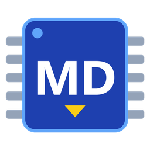
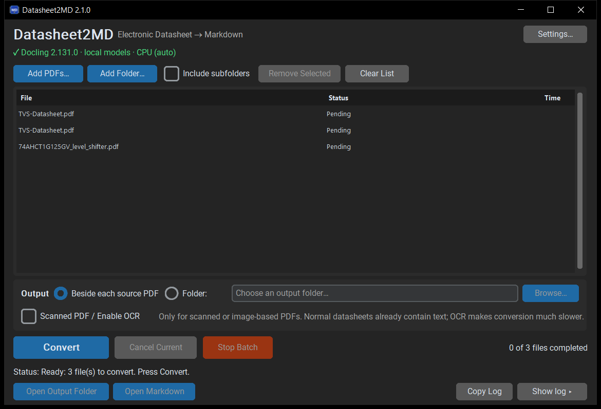

<div align="center">



# Datasheet2MD

**Turn electronic-component PDF datasheets into clean Markdown + PNG images that LLMs can actually read.**

Pinouts, electrical characteristics, register tables and figures, ready for Claude, ChatGPT,
Copilot or your own RAG pipeline. Runs locally on Windows, one PDF or many.




</div>

---

## Use it on your PC (quick start)

Datasheet2MD is a small Windows app. The actual PDF conversion is done by
[Docling](https://github.com/docling-project/docling), which you install once with Python. Nothing
is uploaded anywhere, and no account or API key is needed.

**You need:** Windows 10/11 (64-bit), about 3 GB of free RAM while converting, ~3 GB of disk space
(Python, PyTorch and the AI models), and internet access for the one-time install.

### Step 1: Install Python

Download **Python 3.10, 3.11 or 3.12 (64-bit)** from [python.org](https://www.python.org/downloads/windows/).
In the installer, tick **"Add python.exe to PATH"**.

### Step 2: Install Docling and its models (one time)

Open a **new** PowerShell or Command Prompt window and run:

```powershell
pip install docling
docling-tools models download
docling convert --version
```

The last command should print `Docling version: 2.x`. Verified with Docling 2.131.0.
The model download is about 0.5 GB.

Optional: only if you'll convert *scanned* PDFs, also run `pip install rapidocr onnxruntime`.

### Step 3: Get Datasheet2MD

**Option A: run it from source (easiest).** Needs [Git](https://git-scm.com/download/win), or use
GitHub's *Code → Download ZIP* and unzip it instead of `git clone`.

```powershell
git clone https://github.com/Shihabul-glitch/Datasheet2MD.git
cd Datasheet2MD
python -m venv .venv
.venv\Scripts\python -m pip install -r requirements.txt
.venv\Scripts\python main.py
```

Next time, start it with `.venv\Scripts\python main.py` from the same folder.

**Option B: build your own `Datasheet2MD.exe`.** Run this in the cloned folder:

```powershell
powershell -ExecutionPolicy Bypass -File build\build.ps1 -Mode Both
```

The EXEs appear in `dist\`. `Datasheet2MD.exe` is the normal app; `Datasheet2MD-Debug.exe` is for
the command line. Copy `Datasheet2MD.exe` anywhere you like. It still needs the Docling
installation from Step 2: the EXE contains only the app, not Docling or the models.

### Step 4: Convert

1. Start the app. The top of the window should show **✓ Docling 2.x · …** within a second or two.
   If not, click **Settings…** for diagnostics.
2. Click **Add PDFs…** (or drag PDFs onto the window).
3. Choose **Beside each source PDF** or an output **Folder**.
4. Click **Convert**.

Leave **Scanned PDF / Enable OCR** unticked for normal datasheets.

Each PDF gets its own folder containing `<name>.md` and an `images/` folder. A typical 20-page
datasheet takes 1–4 minutes on a laptop CPU; table-heavy datasheets take longer.

## What it does

1. Add PDFs (multi-select), a folder, or drag & drop files onto the window.
2. Choose where results go: **Beside each source PDF**, or one output folder.
3. Click **Convert**. The files are converted one after another.

Every PDF gets its own folder with exactly one Markdown file and its images:

```
Output/
├── BNO080_085/
│   ├── BNO080_085-Datasheet.md
│   └── images/
│       ├── image_001.png
│       └── image_002.png
└── STM32F103C8T6/
    ├── STM32F103C8T6.md
    └── images/
        └── image_001.png
```

- Tables stay **inside the Markdown** as Markdown tables. Figures are PNG files linked with
  relative paths (`images/image_001.png`), numbered in document order. A figure that contains a
  table in the PDF stays a figure.
- The folder name drops a trailing `-Datasheet` / `_Datasheet` / ` Datasheet`; the Markdown keeps
  the PDF's name.
- Nothing else is written into the document folders: no reports, manifests, JSON or HTML.
  Settings, the file list and logs live in `%APPDATA%\Datasheet2MD\`.
- Nothing is uploaded anywhere, and nothing is rewritten by an AI. The engine is IBM's open-source
  [Docling](https://github.com/docling-project/docling), running locally.

## The main window

| Control | What it does |
|---|---|
| **Add PDFs… / Add Folder…** | Add files (the same file is never added twice). *Include subfolders* applies to Add Folder and to dropped folders. |
| **Remove Selected / Clear List** | Edit the list only; output folders are never touched. |
| **Output** | *Beside each source PDF*, or one *Folder* for all results. |
| **Scanned PDF / Enable OCR** | Off by default. Tick it only for scanned or image-based PDFs (see below). |
| **Convert** | Converts every file in the list that hasn't completed yet, one at a time. |
| **Cancel Current** | Stops the file being converted (nothing is saved for it) and continues with the next one. |
| **Stop Batch** | Stops the file being converted and starts nothing else. |
| **Open Output Folder / Open Markdown** | For the selected file. |
| **Show log** | Expands a log panel; select a file to see its log, warnings and errors. |
| **Settings…** | Processing device (Auto/CPU/GPU) and *Test GPU*, cleanup and debug options, Docling diagnostics. |

The status line always shows the real current step: *Preparing*, *Starting engine*, *Loading
models* (only when they are actually being loaded), *Converting*, *Saving Markdown and images*,
*Checking output*, with the elapsed time. Docling doesn't report per-page progress, so there is
no percentage.

The list is remembered between sessions. If the app was closed during a conversion, that file
shows as *Interrupted*; nothing restarts until you press Convert.

## OCR: when to tick "Scanned PDF / Enable OCR"

Normal datasheets already contain real text, which Docling reads exactly and quickly. **Leave OCR
off** for them.

Tick it only when a PDF is a scan or a picture of text. If a conversion produces very little text,
the app shows a warning suggesting this. It never re-runs a document with OCR on its own, and a
diagram-only or blank page isn't treated as a failure.

With OCR on, Docling runs its OCR engine (on this reference PC: RapidOCR) on page regions that
have no embedded text, and keeps the PDF's own text everywhere else. This is **much slower**:
figures and table regions get OCR'd too (measured: 18-page datasheet, 98 s without OCR vs.
~17 min with OCR, see DEVELOPER_REPORT.md). The OCR engine actually used is written to the log.

## Settings… (technical options)

- **Processing device: Auto / CPU / GPU.** CPU always works.
  - *GPU* needs an NVIDIA GPU **and** a CUDA build of PyTorch in Docling's environment that
    supports the GPU.
  - *Auto* uses the GPU only after **Test GPU** has run a real test conversion successfully on
    this PC. Until then it uses the CPU.
  - If the GPU runs out of memory during a document, that document is converted again on the CPU,
    and a warning says so.
  - On the reference laptop (GeForce MX110, 2 GB), Docling's PyTorch is a CPU-only build
    (`2.14.0+cpu`), so the GPU option is disabled there and the app explains why.
- **LLM-friendly cleanup** (on by default, conservative):
  - fixes `I 2 C` → `I²C`
  - removes repeated page numbers and running footers
  - uses figure captions as image alt text
  - tidies blank lines

  It never rewrites numbers, units, hex/binary values, register names, code or table cells.
- **Debug:** verbose Docling log and keep intermediate files.
- **Diagnostics:** Docling and PyTorch versions, the OCR engines found, the model folder, and the
  paths of settings and logs.

Further options live only in `%APPDATA%\Datasheet2MD\settings.json`:
- `cleanup_*`: individual cleanup rules
- `num_threads`
- `worker_recycle_mb`: worker memory limit
- `engine_backend`: `auto` or `cli`
- `artifacts_path`: model folder
- `docling_path`

## Setup details

The install steps are in [Use it on your PC](#use-it-on-your-pc-quick-start) at the top of this file.

- **The EXE is not self-contained.** It needs a local Docling installation, which brings Python,
  PyTorch and the AI models.
- **How the app finds Docling:**
  - via `PATH` (or `docling_path` in settings), then the Python that owns that `docling.exe`
  - models from `%USERPROFILE%\.cache\docling\models` when complete, otherwise Docling's own
    cache
- **Nothing is installed or changed by the app.**
- **Settings, the file list and logs** are written to `%APPDATA%\Datasheet2MD\` (always
  user-writable).
- **Verified with:** Docling 2.131.0, CPU PyTorch 2.14.0, Python 3.10. Other Docling 2.x versions
  are used as-is; Diagnostics notes the difference.

## Command line

```powershell
# v1.0 syntax still works (output beside the PDF)
Datasheet2MD-Debug.exe --cli "LM358-Datasheet.pdf" [--out DIR] [--ocr] [--no-cleanup] [--debug] [--pages 1-5]

# several files and folders into one output folder, with a JSON summary
Datasheet2MD-Debug.exe --cli datasheets\ extra\ADS1115.pdf --recursive --out D:\md --report batch.json

Datasheet2MD-Debug.exe --self-test     # installation check
```

From source, use `python main.py`. The windowed `Datasheet2MD.exe` has no console output, so use
`Datasheet2MD-Debug.exe` for the command line.

**Options:**
- `--out DIR` / `--beside`
- `--recursive`
- `--ocr`
- `--device auto|cpu|gpu`
- `--no-cleanup`
- `--debug`
- `--pages A-B`
- `--report FILE.json`
- `--stop-on-error`
- `--quiet`

**Exit codes:**

| Code | Meaning |
|---|---|
| `0` | All converted |
| `1` | All failed |
| `2` | Cancelled (Ctrl+C) |
| `3` | Docling not found |
| `4` | Some files failed |
| `5` | No PDFs found |
| `64` | Invalid or removed option |

**Removed in 2.1:** these options are rejected with an explanation instead of being silently
ignored.
- `--overwrite`, `--collision`: output is never overwritten, so a new `NAME_2` folder is created.
- `--ocr-mode auto|force`: use `--ocr` (`--ocr-mode on|off` still works).
- `--timeout`, `--retries`: each PDF is converted exactly once.
- `--report-csv`
- `--continue-on-error`: continuing after a failure is the default.

## How it works

```
PDF ─► staging copy ─► Docling worker (one pass) ─► images/ + cleanup ─► checks ─► publish folder
       (source never     Markdown + referenced PNGs   (image_###.png,        (structure)  (atomic rename)
        modified)                                       relative links)
```

- **One Docling worker per batch.** The app starts a worker inside Docling's own Python, loads
  the models once and reuses them for every file in the batch. Before 2.1, Docling and PyTorch
  were started and loaded again for each file.
  - The worker is shut down after the batch.
  - It is restarted if it crashes, is cancelled, or holds more memory than a limit after a
    document (25 % of RAM, 1.5–4 GB).
  - Cancelling kills only the app's own worker process tree.
- **Docling settings** match Datasheet2MD 1.0:
  - standard PDF pipeline with the docling-parse backend
  - TableFormer *accurate* tables
  - figures exported as PNG at 2× scale
  - OCR only when ticked
  - formula, code and picture enrichment off
  - Markdown is the only export
- **Fallback:** if Docling's Python can't be located, each PDF is converted with
  `docling convert … --to md` (the 1.0 command).
- **Safe output:**
  - Each file is assembled in a hidden staging folder on the output drive and moved into place
    in one step.
  - An existing folder is never overwritten, merged into or deleted: `LM358_2`, `LM358_3`, … are
    created instead. Same-named PDFs from different folders get separate folders.
  - A cancelled or failed conversion saves nothing.
  - If Docling skipped pages, the result goes to `NAME_incomplete` and is reported as
    *Incomplete*, never as success.
- **Checks after each file:**
  - The Markdown exists and is valid UTF-8.
  - Every image link is relative, stays inside the folder and points to a real PNG.
  - No base64 images or absolute paths remain.
  - Cleanup didn't drop tables or headings.
  - The source PDF is unchanged.

  These are structural checks: they don't prove that every value was extracted correctly.
- **Warnings** (shown in the list and log):
  - very little text with OCR off
  - tables with merged cells (Markdown repeats the merged value in each spanned column)
  - missing images
  - unreadable font glyphs

## Building the EXE

```powershell
powershell -ExecutionPolicy Bypass -File build\build.ps1 -Mode Both   # dist\Datasheet2MD.exe + dist\Datasheet2MD-Debug.exe
```

The script creates `.venv`, installs `requirements.txt` (CustomTkinter, tkinterdnd2, pytest,
PyInstaller), runs the tests, builds one-file EXEs (~10.5 MB) and runs `--self-test` on each.

## Troubleshooting

| Problem | Fix |
|---|---|
| *Docling not available* | `docling convert --version` must work in a **new** terminal. Then **Settings… → Retry Docling detection**. Or set `docling_path` in settings.json. |
| Model download stalls at 0 bytes | Some networks can't reach Hugging Face's CDN. The same files (identical SHA-256) are mirrored on ModelScope (`ds4sd/docling-layout-heron`, `ds4sd/docling-models`). Put them in `%USERPROFILE%\.cache\docling\models\…`. |
| Very little text / "enable OCR" warning | The PDF is probably scanned: tick **Scanned PDF / Enable OCR** and press Convert again (the file is still in the list). |
| Conversion is slow | Leave OCR off for normal datasheets. Table-heavy pages are the slowest part: TableFormer *accurate* takes several seconds per table on a laptop CPU. |
| Password-protected PDF | Remove the password first. PDFs that only restrict copying/printing convert fine. |
| SmartScreen warning | The EXE is unsigned: **More info → Run anyway**. |

## Limitations

- Extraction quality is Docling's. Dense register bit-field tables can have cells joined or
  shifted, and merged cells are repeated in Markdown. Spot-check critical pin, limit and register
  tables against the PDF.
- Superscripts and subscripts come out as plain text (`VOH`, `10-3`).
- The GUI converts whole documents; page ranges are on the command line only.
- The GPU is only used with a CUDA build of PyTorch that supports your GPU. The app doesn't install
  one.
- Windows only.

## License

[MIT](LICENSE). Docling is a separate project under its own MIT license. Datasheets you convert remain the property of their manufacturers.
